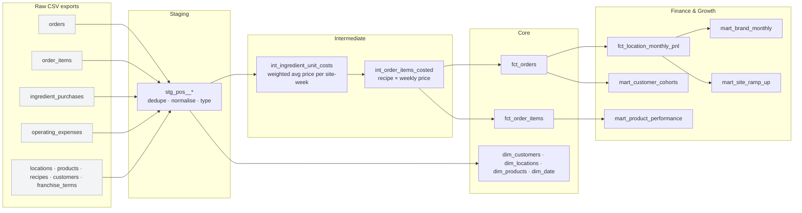

# Happy Dips Analytics Warehouse

A dbt + DuckDB analytics warehouse for a franchised dessert brand: raw point-of-sale, supplier and finance exports in, tested P&L, product, cohort and site-launch models out.

It's modelled on **Happy Dips**, the chocolate-strawberry brand I co-founded in Chennai and scaled from one push cart to a flagship branch and 7 franchises (Dec 2023 – 2025).

> **The data is synthetic.** A generator (`scripts/generate_data.py`) recreates the business's growth path, menu, seasonality and cost structure, but every number is simulated. None of it is real trading data.

**312k orders · 474k order lines · 83k loyalty customers · 9 sites · 25 months**

---

## What it answers

| Question | Model | Finding (synthetic data) |
|---|---|---|
| Is each site profitable, and where does the money go? | `fct_location_monthly_pnl` | Push cart runs the best EBITDA margin (41%): no delivery commission, minimal rent. Franchise sites run at 17–24% after the 8% they pay HQ. |
| What does HQ actually earn vs system-wide sales? | `mart_brand_monthly` | By Dec 2025, ₹92.7 lakh monthly system sales → ₹15.1 lakh HQ contribution (owned-site EBITDA + franchise fees). |
| How did cocoa and strawberry prices hit margins? | `mart_product_performance` | Ingredient margin on the core cup fell from 68% (Q1 2024) to 52% (Q3 2025). Gift Boxes were hit hardest: 59% → 36%. |
| How much stock is wasted? | `fct_location_monthly_pnl` | Ingredient waste runs at 5–9% of spend, worst at the push cart (no cold storage). |
| How fast do new sites reach profitability? | `mart_site_ramp_up` | Most franchises were EBITDA-positive within their first 2 months. |
| Do customers come back? | `mart_customer_cohorts` | 25% of loyalty customers return the month after their first order; 7% are still active at month 6. |
| Are delivery apps worth it? | `analyses/02_channel_profitability.sql` | A delivery order contributes ₹119–126 vs ₹185 for walk-in (35% vs 56% margin). |
| How big is Valentine's week? | `analyses/01_valentines_uplift.sql` | +144% to +171% daily sales vs the rest of February. |
| Which customers should we win back? | `analyses/04_customer_rfm_segments.sql` | "At risk" customers (25% of the base) hold 33% of loyalty revenue: the first target for a win-back campaign. |

## Lineage



## Data quality

The raw exports have problems a real POS system produces, and the staging layer fixes them:

| Issue in raw data | Handled in |
|---|---|
| 1,224 duplicate orders from POS sync | `stg_pos__orders` (`QUALIFY ROW_NUMBER()`); a warn-level source test flags them on every run |
| Inconsistent casing and whitespace (`UPI`, ` swiggy `) | `stg_pos__orders` (`lower(trim())`) |
| Stray whitespace in product names | `stg_pos__products` |
| Refunded orders | Kept for refund analysis, zero recognised revenue |

**68 checks on every build:** uniqueness, not-null, referential integrity and accepted values, plus custom tests:

- order totals equal the sum of their line items
- no orders before a site's opening date
- monthly P&L revenue reconciles to order-level revenue to the rupee
- every sold line picks up an ingredient cost
- composite-key uniqueness on every mart (custom generic test)

## SQL techniques used

Window functions (`ROW_NUMBER`, `RANK`, `LAG`, running `SUM() OVER`, `NTILE`), `QUALIFY`, `FILTER` aggregates, date spines with `range()`, CTE pipelines, cohort analysis, RFM segmentation, Jinja loops in dbt analyses.

## Run it

```bash
python3.11 -m venv .venv && .venv/bin/pip install -r requirements.txt
.venv/bin/python scripts/generate_data.py   # writes data/raw/*.csv (~3 seconds)
.venv/bin/dbt build                          # 24 models + 44 tests
.venv/bin/dbt docs generate && .venv/bin/dbt docs serve   # browse lineage + docs
```

The warehouse is a local DuckDB file (`happy_dips.duckdb`). To run on BigQuery instead, add a BigQuery output to `profiles.yml`. The models use standard SQL apart from a few DuckDB conveniences (`range()`, `QUALIFY`, `FILTER`) that BigQuery also supports or has direct equivalents for.

## Stack

dbt Core 1.12 · DuckDB 1.5 · Python 3.11 (stdlib-only data generator)

---

[Portfolio](https://sanjayprakash-git.github.io/portfolio/) · [LinkedIn](https://linkedin.com/in/sanjay-prakash-a92291186)
